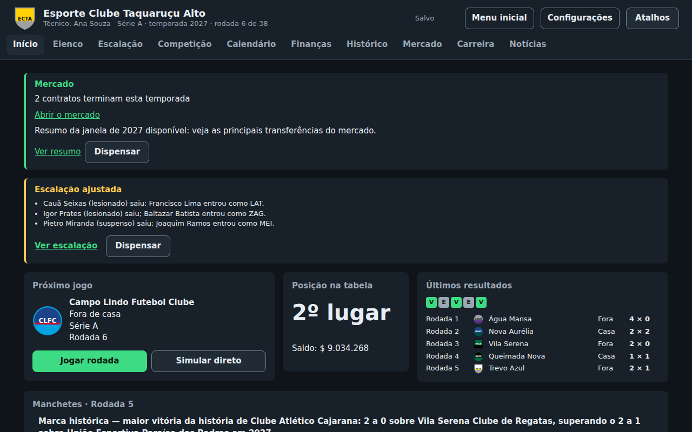

# Treinador FC

[](https://treinador-fc.vercel.app/notas-de-versao/)
[](https://github.com/TrindadeThiago/brasfoot-like/actions/workflows/ci.yml)

Jogo de técnico de futebol no navegador, no estilo do clássico Brasfoot: escolha um clube, monte
o time, jogue as rodadas e construa uma carreira de muitas temporadas. Gratuito, sem anúncios, sem
cadastro e funciona sem internet depois do primeiro acesso.

**Jogar:** https://treinador-fc.vercel.app



## O que dá para fazer

- **Carreira sem fim:** Série A e Série B, acesso e rebaixamento, e um mundo que se renova a cada
  temporada (evolução, aposentadoria e novos jogadores).
- **Partidas:** rodada ao vivo com substituições ou simulação direta, tabela, artilharia e
  calendário.
- **Copa nacional:** mata-mata com prorrogação e pênaltis ao vivo, chaveamento e histórico de
  campeões; mods podem descrever copas só com dados.
- **Clube:** escalação, finanças, estádio e ingressos.
- **Mercado de transferências:** janelas, propostas, contratos e empréstimos, com a IA montando os
  elencos dos outros clubes.
- **Drama:** diretoria com metas e demissão, propostas de outros clubes, torcida, rivalidades,
  manchetes e histórico.
- **Carreiras portáteis:** exportar e importar a carreira em arquivo `.blsave`.
- **Mods:** carregar outros bancos de dados de clubes e jogadores, feitos pela comunidade.
- **Interface nova:** barra lateral, tema claro e escuro e telas que funcionam de tablet (a partir de
  768 px) a monitor grande, sem rolagem horizontal da página.
- **Acessível:** contraste mínimo de 4,5:1, foco visível, uso só com o teclado (`?` mostra os
  atalhos de cada tela), leitor de tela, movimento reduzido e dicas no primeiro acesso.

Todos os clubes, jogadores, escudos e competições do jogo são **fictícios**. O jogo não distribui
nomes, escudos ou marcas reais; quem quiser pode carregar mods com outros bancos de dados.

## Como funciona

Monorepo pnpm em TypeScript. Toda a regra de jogo vive num motor puro, sem React nem APIs do
navegador, e é determinística: a mesma seed dá sempre o mesmo resultado.

| Pasta | Conteúdo |
|---|---|
| `packages/engine` | Motor: partidas, temporada, carreira, finanças, mercado, diretoria, torcida e manchetes |
| `packages/save` | Formato do save versionado, migrações e export/import `.blsave` |
| `packages/modkit` | Pacotes de mod (`.zip`), CSV e imagens de escudo |
| `packages/i18n` | Textos da interface (pt-BR), mensagens de erro e notas de versão |
| `apps/web` | Interface em Next.js (static export) com service worker para jogar offline |
| `mods/default`, `mods/exemplo` | Banco fictício padrão e mod de exemplo |
| `tools` | Scripts: geração do banco, validação de mods, simulações de balanceamento e release |

Os saves ficam no IndexedDB do navegador; não há servidor.

## Desenvolvimento

Requisitos: Node.js 22.13 ou mais novo e pnpm (versão em `packageManager` do `package.json`).

```bash
pnpm install
pnpm dev:web          # servidor de desenvolvimento
pnpm build:web        # build estático em apps/web/out
pnpm preview:web      # serve o build em http://localhost:4173
```

### Testes e verificações

```bash
pnpm typecheck && pnpm lint && pnpm test   # tipos, Biome e testes unitários (Vitest)
pnpm build:web && pnpm test:e2e            # e2e com Playwright (inclui acessibilidade e offline)
pnpm sim:world --seasons 30                # balanceamento do mundo em 30 temporadas
pnpm sim:economy --seasons 30              # balanceamento da economia em 30 temporadas
```

Para o e2e, instale o Chromium uma vez: `pnpm --filter @brasfoot-like/web exec playwright install chromium`.

### Outros scripts

| Script | Faz |
|---|---|
| `pnpm validate-bank <pasta ou .zip>` | Valida um banco de dados ou mod e lista todos os erros |
| `pnpm gen:default-bank` | Gera o banco fictício padrão (`mods/default`) |
| `pnpm gen:example-mod` | Gera o mod de exemplo e o pacote para download no jogo |
| `pnpm screenshots` | Gera as capturas da página Sobre e deste README (tema escuro) e os ícones do aplicativo, a partir do build |
| `pnpm check-release` | Verificações antes de publicar (versão, notas, capturas, textos e tamanho do pacote) |
| `pnpm sim:gates` | As três simulações de 30 temporadas (mundo, economia e mundo grande), antes de publicar |
| `pnpm hooks:install` | Liga o gancho de pré-push, que roda `pnpm sim:gates` quando o push mexe no motor, no save, no modkit ou nas ferramentas (`SKIP_SIMS=1 git push` pula) |

## Publicação

O site é estático e fica na Vercel, mas o projeto **não** é conectado ao GitHub: nada vai ao ar
a cada push. Para publicar uma versão:

1. Atualize `version` no `package.json` da raiz e adicione as notas da versão em
   `packages/i18n/locales/pt-BR/release-notes.json`.
2. Faça o merge na `main`. Não é preciso criar a tag.
3. O workflow [`release`](.github/workflows/release.yml) dispara no push na `main`: se a versão do
   `package.json` ainda não tem tag, confere tipos, lint, build e `check-release`, publica o build
   conferido e então cria a tag `vX.Y.Z` e a release no GitHub com as notas. Merge sem mudança de
   versão não publica nada. Os testes de unidade e o e2e rodam no PR ([`ci`](.github/workflows/ci.yml)), e
   as simulações de 30 temporadas rodam só localmente (veja abaixo): para economizar minutos de
   Actions, o release não repete nada disso.

O badge de versão acima lê o `version.json` do site publicado, então muda sozinho a cada release.

### Gastar poucos minutos de Actions

- O `ci` não roda em PR em rascunho nem em mudança só de documentação ou de `.github/`.
- O e2e (o job mais caro) só roda em PR para a `main`, com o rótulo `e2e` ou quando o PR muda
  `apps/web/e2e/`; PRs de feature para uma branch de release rodam só tipos, lint e unidade.
- Antes do PR final para a `main`, rode localmente `pnpm test:e2e` e `pnpm sim:gates`.

As versões 1.0.0 a 1.10.0 (20 a 28 de outubro de 2026) são a **fase beta** do jogo: as tags e os
Releases delas se chamam `beta-vX.Y.Z`. A numeração foi reiniciada no marco 10 (a interface nova),
desenvolvido na branch `release/v1.0.0` e publicado de uma vez como o lançamento oficial 1.0.0
(`v1.0.0`): um PR de `release/v1.0.0` para a `main`, com merge commit, que dispara o workflow de
release. Antes dele, os gates do release (simulações de 30 temporadas, `check-release` e e2e
completo) rodam sobre a branch. Ver [`docs/interface-nova.md`](docs/interface-nova.md), seção 6.

## Documentação

- [Documento de design](docs/design.md): visão, regras do jogo e roadmap
- [Formato de mods](docs/mod-format.md): estrutura dos pacotes, campos, CSV, imagens e erros
- [Glossário de textos](docs/glossario.md): termos e tom usados na interface
- [`specs/`](specs/): especificação, plano e tarefas de cada feature (Spec Kit)
